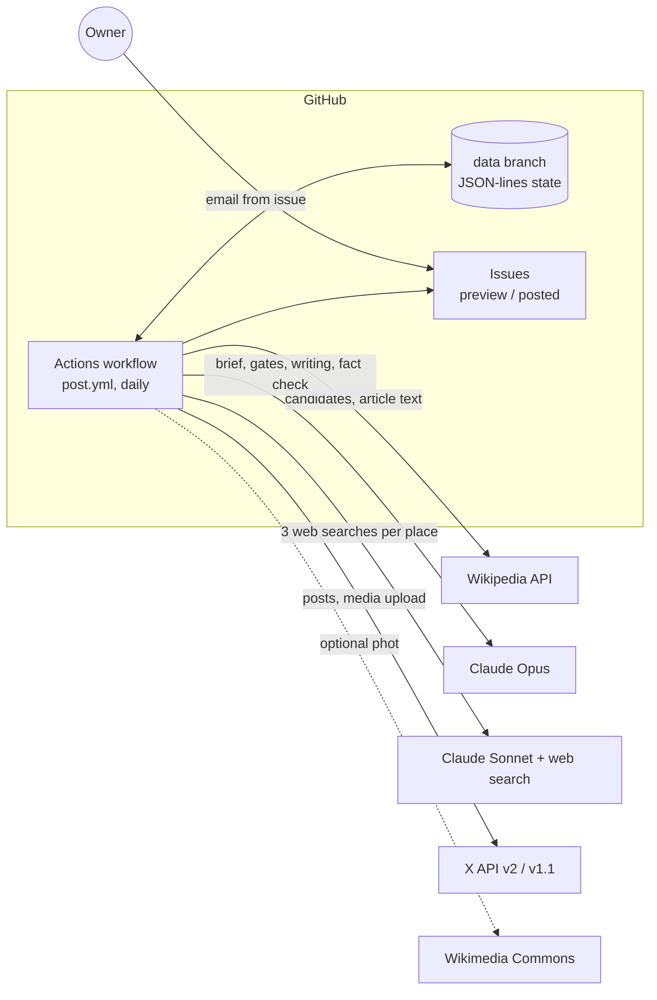
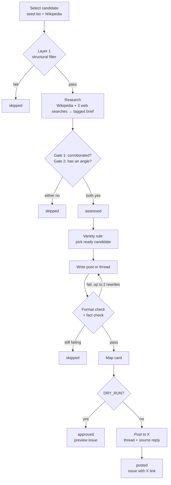
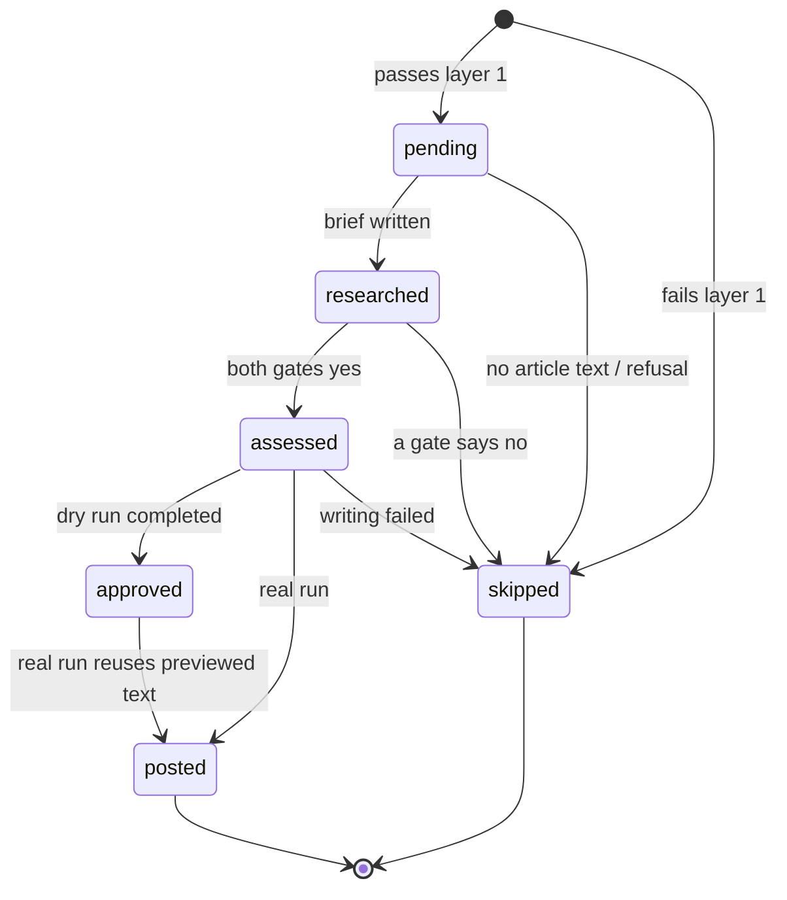
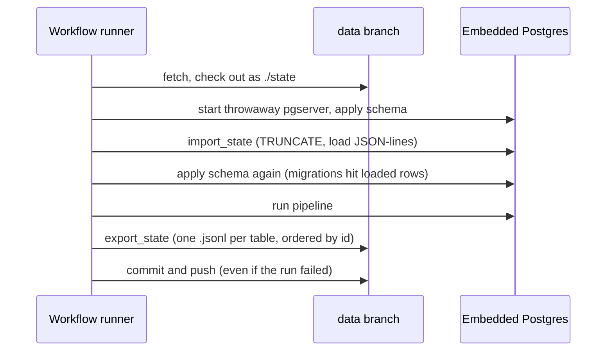

# Architecture

How "Why Do People Live Here?" is built, why it is built that way, and what each choice costs.

The README is the user manual and `CLAUDE.md` is a short list of conventions. This document is the long-form reference: the components, how data moves between them, and the trade-offs behind the main decisions. It describes the code as it is, not as it might become.

## 1. What the system does

Once a day it posts one explainer about an obscure remote settlement to X (Twitter): a single post or a thread of up to four, with a locator map on the first post and a closing reply that names the source.

The hard part is not posting. It is posting only things that are **true** and **interesting**, unattended. Most of the design serves those two goals, under two constraints: the account runs for close to nothing, and no server has to be kept alive.

## 2. System context

There is no long-running service and no hosted database. Each run starts on a fresh runner, rebuilds its memory from the `data` branch, does its work, and writes the memory back.

## 3. The pipeline

### 3.1 Components

| Stage | Module | Input → output | Model |
|---|---|---|---|
| Select | `pipeline/candidate_selector.py` | `config/seed_categories.yaml` → a `pending` row in `candidates` | none |
| Research | `pipeline/researcher.py` | candidate → `research` row (brief) + region, status `researched` | Sonnet (search), Opus (synthesis) |
| Assess | `pipeline/assessor.py` | brief → `assessments` row, status `assessed` or `skipped` | Opus |
| Write | `pipeline/content_generator.py` | brief + editor notes → list of posts | Opus (writer and fact checker) |
| Measure | `pipeline/xtext.py` | text → length as X counts it | none |
| Illustrate | `pipeline/map_card.py`, `pipeline/image_sourcer.py` | place → PNG card, or a licensed photo | none |
| Publish | `pipeline/publisher.py`, `pipeline/preview.py` | content → X posts, `posts` row, Markdown preview | none |
| Orchestrate | `scheduler/run_pipeline.py` | counts, `DRY_RUN` → N posts | none |
| Cost | `pipeline/llm.py` | every request → token and cost tally | n/a |

Supporting code: `db/` (schema, pool, state export/import), `scripts/` (local runner, credential tools, seed verifier), `assets/` (profile art).

### 3.2 Candidate selection

Each story category in `seed_categories.yaml` (`ghost_town`, `company_town`, `colonial_resettlement`, `extreme_climate`, `island_community`, `isolated`, `border_oddity`) has two possible sources:

- **Wikipedia categories**, crawled one subcategory deep (up to 10 random subcategories).
- **Hand-picked article titles** (~217), for story types Wikipedia categories cover badly.

Categories are shuffled; the one used by the last post goes last. Within a category the sources and members are shuffled, and at most 10 unseen members are tried per source.

**Layer 1** is a free, no-LLM filter: the REST summary has a `description` (rules out disambiguation pages), the full text is at least 500 characters, and some section name contains Economy, History, Background or Origin. Crawled articles must also have coordinates, which removes films, lists and concept pages like "Company town". Hand-picked titles skip the coordinate check because a person already vetted them.

Every article tried is written to `candidates`, including failures (`skipped`), so it is never fetched twice. `wikipedia_url` is the unique key.

### 3.3 Research

For one place, in parallel:

1. Fetch the full Wikipedia text.
2. Run three Claude web searches, one per aspect: **origin**, **livelihood**, **daily life**. Each is limited to 3 searches. Wikipedia, its sister sites and known mirrors are blocked.

An Opus call then merges them into one **research brief**. Every sentence ends with source tags: `[W]` for Wikipedia, `[1]`, `[2]`… for numbered web passages. The brief must contain only what the sources say. The same call returns the continent (`region`).

The tags are the central device in the design. They let the assessor judge corroboration by reading the brief, and they confine the writer to material that has a source.

### 3.4 The two gates

The assessor reads only the brief and answers two yes/no questions, writing its reason before each verdict:

1. **corroborated** — is the central answer (why the place exists, or what keeps people there) supported by a web source as well as `[W]`?
2. **has_angle** — would a general reader find it surprising that people live there, and does the brief explain why?

Both must be yes. It also writes `writer_notes`: the strongest material and anything disputed.

### 3.5 Writing and fact checking

The writer sees only the brief and the editor's notes. It chooses the length: one post, or a thread of three to four. It opens with the most surprising fact and ends the first post with the question.

Each draft then faces two checks:

- **Format, in code:** 1–4 posts, each at most 280 characters by X's counting rules (links count as 23, some symbols as 2).
- **Fact check, a separate model call:** every number, date, name, quotation and causal claim is compared with the brief. Anything unsupported, overstated ("about" dropped, "is said to" made flat) or disputed is returned.

A failing draft goes back to the writer with the specific problems, at most twice. If it still fails, the place is `skipped`.

### 3.6 Publishing

`run_publish` assembles the images, the replies and the record:

- **Image:** a map card (on by default), or if that is impossible and `POST_IMAGES=true`, a public-domain Commons photo.
- **Replies:** the thread's remaining posts, then a footer naming the source article and a follow line.
- **Post:** `tweepy` to the X v2 API; media upload uses v1.1, the only place it exists.
- **Record:** a `posts` row, the candidate set to `posted` (or `approved` for a dry run), and a Markdown preview file.

If the first post fails, nothing was published and the error propagates. If a later reply fails, the thread is left as far as it got and the place is still recorded as posted.

### 3.7 Orchestration

`_post_one` produces one post:

1. Look up the last post's region and story category.
2. While a ready candidate exists (`assessed`, plus `approved` in a real run) that is not in the last post's region, try to publish it, preferring a different story type.
3. If none, prepare up to `--parallel` new candidates concurrently (resume unfinished ones first), then look again. Stop after 5 candidates prepared.
4. If nothing new can be prepared, drop the region rule and post a same-region candidate rather than nothing.

## 4. State machine

A candidate carries its progress in `candidates.status`:

Because every stage writes its result and status before the next begins, a crashed run resumes where it stopped and never repeats paid work.

## 5. Data model

Five tables, defined in `db/schema.sql`:

| Table | Holds | Notes |
|---|---|---|
| `candidates` | place, URL (unique), story category, region, status, layer 1 result | the state machine above |
| `research` | web sources (JSONB), brief | `wikipedia_extract` is not saved to state |
| `assessments` | both verdicts, both reasons, writer notes, `passed` | |
| `posts` | text, thread parts (JSONB), image, X post ID, `dry_run` | dry-run rows are the "previewed text" |
| `variety_log` | region and story category of each real post | see 8.4 |

Related tables are children of `candidates` with `ON DELETE CASCADE`. `schema.sql` is **idempotent and re-applied on every run**, so a migration is just an extra `UPDATE` or `DROP IF EXISTS` at the bottom (for example the 0–10 score migration and the `exclave` → `border_oddity` rename).

## 6. State and deployment

### 6.1 Where memory lives

Postgres exists only while a run is in progress. Between runs the truth is a set of text files, one per table, one row per line, ordered by id, so a day's activity is a handful of added lines in `git log data`.

`scripts/run_local.py` offers three homes for state: a persistent `.dryrun-pg/` directory (default), `--state-dir` (what the workflow uses), and `--shared` (the same `data` branch, fetched before and pushed after). `scheduler/run_pipeline.py` can instead use any `DATABASE_URL`, and `docker-compose.yml` and the `Dockerfile` support that path.

### 6.2 The daily workflow

`.github/workflows/post.yml`:

- Cron `17 9 * * *` UTC, plus manual dispatch with a post count. GitHub has been starting it about five hours late, so it lands near 14:30 UTC.
- `concurrency: daily-post` so two runs never choose the same candidate or push state over each other.
- **Preview mode by default.** Without `PUBLISH_TO_X=true` nothing goes to X; each post becomes a GitHub issue labelled `preview`, assigned to the owner, which GitHub emails.
- **Publishing mode** (`PUBLISH_TO_X=true` plus four X secrets) posts for real and files `posted` issues with the X link.
- State is saved with `if: always()`, so a post that went out before an error is not forgotten.
- A missing `ANTHROPIC_API_KEY` skips the run with a warning; exhausted Anthropic credits end the run with one readable error and state still saved.

### 6.3 CI

`ci.yml` runs `ruff`, the test suite on Python 3.11 and 3.12, and a check that no hand-picked place is listed twice. It needs no secrets: Claude, Wikipedia and X are faked, and integration tests use a real embedded Postgres.

## 7. Cross-cutting concerns

**LLM access (`pipeline/llm.py`).** Two entry points: `parse` (Opus, structured output validated by a Pydantic model) and `web_search_citations` (Sonnet with the web search tool, returning cited passages). Both share a semaphore of six in-flight requests per event loop, record tokens per model, and enable the server-side fallback beta so a refused request can be retried on a fallback model. A remaining refusal raises `LLMRefusalError`, which the orchestrator turns into a skipped candidate. A search turn that pauses is resumed up to three times.

**Cost visibility.** Each run prints token use and an estimated dollar cost per model. The estimate excludes Anthropic's per-search fee and X's per-post charge.

**Wikimedia etiquette.** All requests send a User-Agent with a contact address (or get a 403), and HTTP 429 responses are retried after `Retry-After`, capped at 60 seconds.

**Failure containment.** Network errors in the selector skip an article instead of failing the run. Model refusals and unusable drafts skip the candidate. Image failures post without the image. A reply failure leaves a partial thread rather than risking a duplicate hook.

**Safety against accidental posting.** Nothing publishes unless `DRY_RUN=false`, which only `--publish` (with a typed confirmation) or `PUBLISH_TO_X=true` set. Tests fake X entirely.

## 8. Design decisions and trade-offs

Each entry says what was chosen, what it buys, and what it costs.

### 8.1 Two yes/no gates instead of a score

- **Chosen:** corroborated and has_angle, both required (replaced a weighted 0–10 score, PR #6).
- **Why:** the score was a soft judgement with placeholder weights, and totals clustered at 9–10 even after the rubric was tightened. Binary questions with a written reason are easier to audit and harder to drift.
- **Cost:** no ranking. A marginal place and an excellent one both pass, and there is no "best of today's candidates" step. The gate only protects the floor, not the ceiling.

### 8.2 Independent corroboration, with Wikipedia and mirrors blocked

- **Chosen:** web search excludes Wikipedia, Wikidata, DBpedia and known mirrors; gate 1 needs support from outside Wikipedia.
- **Why:** Wikipedia is the seed. If a mirror counted as a second source, a claim could corroborate itself.
- **Cost:** the blocklist is a hand-maintained list of domains. A new mirror it does not know about would slip through. Some places have good coverage only on Wikipedia and are rejected, which narrows the pool toward places with press coverage.

### 8.3 The brief is the only truth

- **Chosen:** the writer works from the brief alone, and the fact checker compares drafts to the brief, not to the world.
- **Why:** it makes accuracy a checkable property of a text rather than a hope about model memory. Source tags make the chain from claim to source visible.
- **Cost:** errors in the brief pass through. If the synthesis mistranscribes a source, or a web page is wrong, the fact check will approve the repeated error. The check guards against the writer inventing, not against the brief being wrong. It also costs more calls: one per draft, and up to three drafts.

### 8.4 Model split: Sonnet for search, Opus for judgement

- **Chosen:** Sonnet runs web search; Opus does synthesis, gates, writing and fact check (PR #9).
- **Why:** search reads tens of thousands of tokens per call and is most of the cost (about $0.24 of research per place on Sonnet). Finding and quoting sources needs less judgement than deciding what is true.
- **Cost:** the weaker model decides which sources the rest of the pipeline sees. A poor search result cannot be repaired downstream. The price table in `llm.py` is hand-maintained and goes stale.

### 8.5 Basic web search tool

- **Chosen:** `web_search_20250305`, not the newer version.
- **Why:** the newer tool ran searches in a code sandbox where failed attempts consumed the search budget, and its text came back without citations, so no sources could be extracted.
- **Cost:** pinned to an older tool version that may be retired. Revisit if citations are fixed upstream.

### 8.6 Three narrow searches rather than one broad one

- **Chosen:** origin, livelihood and daily life as separate concurrent searches.
- **Why:** narrow questions return faster and between them cover more, which is what the corroboration gate needs.
- **Cost:** three times the search fee and some duplicated sources (deduplicated by URL and snippet afterwards).

### 8.7 Writer decides length, capped at four

- **Chosen:** one post or a thread of at most four.
- **Why:** with a cap of five, every thread came back as five. A cap forces choosing what to leave out. Most readers see only the first post, so the hook carries the most weight.
- **Cost:** rich places lose material. The cap is a blunt instrument, but the brief is always longer than a thread can hold.

### 8.8 Fact check on every draft, with a bounded rewrite loop

- **Chosen:** up to two rewrites, then drop the place (PR #19).
- **Why:** unattended posting needs a hard stop on unsupported claims. Dropping the place is cheaper than a public error.
- **Cost:** a model checking a model. A false positive wastes a rewrite; a false negative posts. A second Opus call per draft adds cost and latency. Failed places are marked `skipped` permanently, even if a different draft might have passed.

### 8.9 No hosted database; state as git files

- **Chosen:** JSON-lines per table on a `data` branch, loaded into a throwaway embedded Postgres each run (PR #7).
- **Why:** nothing to sign up for, nothing that expires or goes cold, every change reviewable in `git log`, and the same code runs locally and in CI. Earlier options (throwaway container, Actions cache, a `DATABASE_URL` secret) lost history or needed an account.
- **Cost:**
  - Whole-database rewrite each run, so it is fine at hundreds of rows and will not scale to millions.
  - Concurrency is by convention. The workflow's `concurrency` group serialises Actions, but a local `--shared` run at the same time as the workflow can produce a non-fast-forward push.
  - Article text is dropped from saved state, so a `researched` candidate resumed on a later run has its brief but not its extract. That is fine, since the brief is the only thing downstream uses.
  - Postgres is used mainly for its SQL and JSONB. A lighter store (SQLite) would work, but the Postgres code was already written and `jsonb_populate_recordset` makes the import a single statement.
  - The `data` branch holds plaintext history of every brief. That is public if the repository is.

### 8.10 Preview-first, and "what was previewed is what gets posted"

- **Chosen:** dry runs store content and mark the candidate `approved`; a real run publishes that exact text first.
- **Why:** previews are not wasted, and what the owner read is what goes out. Preview mode is the default, so nothing posts by accident.
- **Cost:** `approved` is automatic. The owner cannot reject a preview without editing state by hand, which is why issue-label approval is the top item in "Potential next features". Today preview is notification, not control.

### 8.11 Variety by rotation and parking

- **Chosen:** the last post's story type is tried last; a same-continent candidate is parked (research kept) for later; parallel batches are spread across story types.
- **Why:** an account that posts five ghost towns in a row loses its audience.
- **Cost:** it is a soft rule. If only same-region candidates remain, the region rule yields so a day is not lost. "Region" is a continent, which is coarse. `variety_log` is written on each real post but the rule reads from `posts` joined to `candidates`, so the table is currently write-only.

### 8.12 Map cards over photos

- **Chosen:** a locator card drawn from public-domain Natural Earth data, on by default. Photos are an opt-in fallback limited to CC0 and public-domain Commons files (PR #21, #31).
- **Why:** no licence risk, consistent look, alt text we author ourselves. Posting to X grants X a sublicensable licence that CC BY and CC BY-SA cannot pass on, and attribution slips under older CC versions terminate the licence.
- **Cost:** a map is less evocative than a photo. Places without Wikipedia coordinates get no card. Mislabelled Commons files remain a residual risk, which is why photos stay off. The card depends on installed fonts (DejaVu on the runner, Arial on macOS), so cards differ slightly by machine.

### 8.13 Naming the source instead of linking it

- **Chosen:** the closing reply says "Source: Wikipedia, “Title”" with no URL (`SOURCE_LINK=false`).
- **Why:** X is pay-per-use, about $0.015 for a plain post and about $0.20 with a link.
- **Cost:** readers must search for the source. An easy toggle exists if pricing changes. The follow line rides on the source reply so it adds no extra post.

### 8.14 Partial threads count as posted

- **Chosen:** if reply 3 fails, the place is recorded as posted.
- **Why:** the hook is public. Retrying the whole thread would publish it twice.
- **Cost:** a visibly truncated thread can stay up. There is no repair step, and the closing source reply is lost when a thread stops early.

### 8.15 Resumable by construction

- **Chosen:** every stage persists before the next starts; up to five candidates are prepared per run; failed runs still save state.
- **Why:** expensive work (research is most of the money) is never repeated, and a crash after a post never causes a repeat.
- **Cost:** more states to reason about, and a candidate stuck mid-pipeline for a deterministic reason will be retried every run until it gets skipped. The orchestrator catches `LLMRefusalError` and `ValueError` only; other exceptions abort the run.

### 8.16 Scheduling around GitHub's delay

- **Chosen:** cron at 09:17 UTC to land near 14:30 UTC.
- **Why:** observed behaviour: the workflow starts about five hours late. 14:30 UTC is daytime for the Americas, Europe and India.
- **Cost:** this is an assumption about a platform we do not control. If the delay disappears, posts go out five hours early. A drift guard is on the ideas list.

## 9. Known gaps and risks

These come from reading the code and are worth deciding on, not necessarily fixing.

1. **Approval is not enforced.** Anything that passes the gates is eligible to post. Owner review depends on the owner reading an issue before the next real run.
2. **Brief errors are invisible to the fact check** (8.3). The weakest link is the synthesis step and the search results it reads.
3. **Wikipedia is both the seed and a source tag.** Gate 1 enforces one independent source, not two. A single weak web page is enough.
4. **`variety_log` is unused for decisions** (8.11).
5. **Narrow exception handling.** A transient API error (other than credit exhaustion) in one candidate's research stops the whole run rather than skipping it. State is still saved, and the next run resumes.
6. **Blocklist and tool versions are pinned by hand** (8.2, 8.5), as is the model price table.
7. **State rewrite and push race** (8.9) if a local shared run overlaps the workflow.
8. **Cost reporting is incomplete.** Search fees and X charges are not in the run total.
9. **Single platform, single account.** `publisher.py` talks to X directly.

## 10. Extension points

| To add… | Touch |
|---|---|
| A story category | `config/seed_categories.yaml` (then `scripts/verify_seed_places.py`); no code change |
| A table or column | `db/schema.sql` as an idempotent statement; add the table to `TABLES` in `db/state.py` |
| A publishing platform | an interface in `pipeline/publisher.py`; its own length rules next to `pipeline/xtext.py` |
| A new editorial rule | a gate in `pipeline/assessor.py` (a field on `Assessment` and its prompt) |
| A new brief source | `pipeline/researcher.py`: add its text to the synthesis input and give it a tag |
| Approval from issues | `.github/workflows/post.yml`, `pipeline/preview.py`, `scheduler/run_pipeline.py` |

The full list of planned work, with rationale, is in `CLAUDE.md` under "Potential next features".
